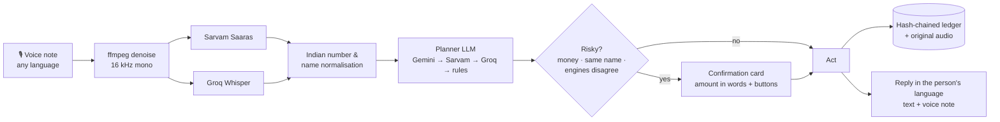
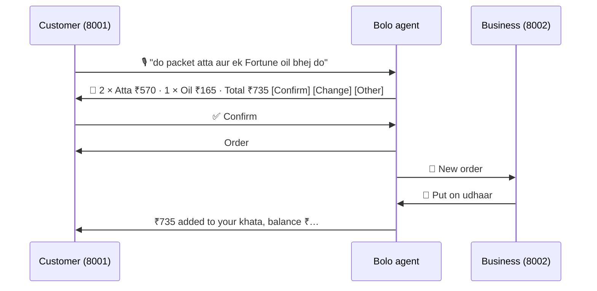

# Bolo

**India's shops keep talking on WhatsApp. Bolo turns every voice note into a record both sides agree on.**

A shopkeeper or customer sends a voice note in Kannada, Hindi, Hinglish, Tamil or English. Bolo cleans the audio, hears it with two speech engines, understands Indian number words and names, and turns it into something the business can act on: a khata entry, a priced order, a dispute, a payment claim, a team poll or a PDF statement. Anything involving money is read back for a one-tap confirmation. Every entry keeps its original recording in a tamper-evident, hash-chained ledger.

Team Axon · Rewired 2026 (Masters' Union, Road to Milky Way, Bangalore) · Problem: *India runs on WhatsApp* · Gravity Well: **ECHO**, where the way in is a voice note.

---

## Three doors, one agent

| Port | Who | What you get |
|---|---|---|
| **8000** | Everyone | Product landing page (`/site/`), owner dashboard (`/console/`), API |
| **8001** | Customers | Full-screen WhatsApp-style chat with the shop: voice notes, reply buttons, PDFs, voice replies |
| **8002** | The business | Login, the shop's assistant (run the shop by voice), **every customer chat live**, reply as the business, customise the bot |

All three run from one process (`backend/serve.py`) and share one SQLite database, so a voice note on the customer side appears on the business side immediately.

## Quick start

**Docker (no API keys needed):**
```bash
docker compose up --build
```
Open http://localhost:8000 (landing) · http://localhost:8001 (customer) · http://localhost:8002 (business). On the business side, log in with any shop name and number and tick *fresh book with sample customers*.

Key-free mode uses local Whisper (tiny) and eSpeak NG, so speech is rough and voice notes open a transcript review. For the real experience, copy `.env.example` to `.env`, add `SARVAM_API_KEY`, `GROQ_API_KEY` and `GEMINI_API_KEY`, and run `BOLO_OFFLINE=0 docker compose up`.

**Without Docker (Windows, Python 3.11+):**
```powershell
cd backend
pip install -r requirements.txt
python serve.py
```

**On a phone:** `cloudflared tunnel --url http://localhost:8000`, then open `https://<tunnel>/chat/` (customer) or `https://<tunnel>/business` (business). The mic works over HTTPS.

**Wireless/USB mic:** in either chat, ⋮ → Microphone → pick the device. A green level bar moves while it hears you.

## How a voice note becomes an action





## Demo stories
One-line copy-paste cheat sheet: **[docs/demo-lines.md](docs/demo-lines.md)**. Eight role-play stories (two Rameshes, voice orders, the ₹350 dispute, "I paid on GPay", the team poll, the Khata Passport, the owner's price broadcast and the English-speaking customer) with exact lines to speak: **[docs/demo-stories.md](docs/demo-stories.md)**. Pitch, GTM and judge Q&A: [docs/pitch.md](docs/pitch.md).

## WhatsApp: what's real and what's simulated
- The agent, speech, planner, ledger, PDFs and voice replies are real and run on every message.
- The **chat surface** on ports 8001/8002 is a WhatsApp-style simulator. The same agent also has real adapters for the Meta WhatsApp Cloud API (`pipe/whatsapp.py`) and Twilio (`pipe/twilio.py`). On 19 Nov our server received real WhatsApp messages, but trial accounts block replies until the account is approved (details in [docs/demo-stories.md](docs/demo-stories.md#limits-we-hit-today-paperwork-not-code)).
- **Groups:** a WhatsApp Business Platform number can't join an ordinary group. Bolo runs 1:1 chats and fans out group-style tasks (polls, announcements) privately with a shared tally. See [WhatsApp groups](docs/demo-stories.md#whatsapp-groups-what-is-and-isnt-possible).

## Repository map
| Path | What |
|---|---|
| `backend/serve.py` | Starts the three ports |
| `backend/app.py` | FastAPI: API, simulator endpoints, webhooks, static apps |
| `backend/brain/` | Agent, planner, Indian number/date normalisation, LLM calls |
| `backend/core/` | Hash-chained ledger, contacts and cross-script name matching, permissions |
| `backend/features/` | Business profiles, knowledge base, polls, documents (PDF) |
| `backend/voice/` | Audio cleanup, two-engine STT, TTS, translation, document AI, local models |
| `backend/pipe/` | Messenger (the only way out), WhatsApp Cloud API, Twilio, webhook inbox |
| `chat/` | Customer and business WhatsApp-style apps (one file, no build step) |
| `frontend/` | Owner dashboard |
| `product-demo/` | Landing page |
| `docs/` | Architecture, agent, pitch, demo stories, setup guides |

## The jugaad we replace

A typical neighbourhood kirana today:
- Customers send orders as **voice notes** in Kannada, Hindi, Tamil, Telugu, English, or all of them in one sentence.
- The owner listens to them one by one during rush hour, scrolls back to find the pending ones, and packs from memory.
- Credit lives in a **paper notebook**. "Likh lo" is said in a voice note and written down later, or not at all.
- At month end: "Maine kab liya?" The notebook says one thing and the customer remembers another. The voice note is somewhere 400 messages up.

**Where it breaks** (each one is shown in the demo):
| Break | What happens | Cost |
|---|---|---|
| Lost in scroll | Order voice note buried under forwards and group spam | missed sale, angry customer |
| Misheard | wrong item, quantity or brand packed | return trip, waste |
| Unrecorded credit | udhaar said aloud, never written | money that is never recovered |
| Disputed credit | no proof of who said what, when | lost money and a lost customer |
| No reminders | owner embarrassed to ask | dues age into bad debt |
| Owner bottleneck | one person must listen to everything | can't scale past one phone |

## What Bolo does

1. **Customer talks as usual**: "Anna, two kilo atta, one Fortune oil, put it on my account."
2. **Bolo understands it** with Indic speech recognition, then matches against *this shop's* catalog and customer list.
3. **Bolo talks back**, in the customer's language: "2 kg Aashirvaad atta, 1 L Fortune oil, ₹318 on credit. Correct?" The customer says "haan". If Bolo is confident, it commits directly.
4. **The shop sees a ticket**, not a voice note: a live order queue, a pick-list, and a ledger.
5. **Every rupee of credit carries proof**: the entry stores the original voice note and a hash chain, so it can't be edited quietly. A dispute ends with one tap: *play the original*.
6. **Bolo chases dues politely**: voice reminders and weekly statements, in each customer's own language.

## Who it serves
| Layer | Person | What they get |
|---|---|---|
| Direct | Customer | Order and credit by voice, a spoken receipt, "kitna baaki?" answered instantly |
| Direct | Shop owner | A queue instead of a scroll, a ledger instead of a notebook, money recovered |
| Direct | Shop staff / delivery boy | "Ramesh's order delivered" by voice marks it done |
| Indirect | Distributor | Reorder-by-voice, aggregated demand (opt-in) |
| Indirect | Lender | Consented credit history for working-capital loans |
| Indirect | City | The informal credit economy, *counted* for the first time (anonymised) |

Agent design: [`docs/agent.md`](docs/agent.md) · AI stack: [`docs/ai-stack.md`](docs/ai-stack.md) · Details: [`docs/product.md`](docs/product.md) · Market and go-to-market: [`docs/market.md`](docs/market.md)

## How it works
See [`docs/architecture.md`](docs/architecture.md).

```
voice note ─► speech-to-text (Indic) ─► grounded extractor (catalog + customers) ─► confidence gate
                                                                                    ├─ sure  ─► commit
                                                                                    └─ unsure ─► spoken read-back ─► "haan" ─► commit
commit ─► order queue · udhaar ledger (hash-chained, audio-backed) ─► voice receipt in the user's language
```

## Run the key-free demo

On Windows with Python 3.11 or later, run this from the repository root. First setup installs the dependencies and downloads the multilingual Whisper tiny model (76 MB of weights). Later launches reuse it. Speech runs on one CPU thread. The launcher disables all hosted providers, even when the machine has API keys.

```powershell
.\scripts\start-demo.ps1
```

Open **http://127.0.0.1:8000**, choose **Kirana demo**, then **Open phone simulator**. On macOS or Linux, create a Python virtual environment, install `backend/requirements.txt`, then run `python -m voice.setup` and `BOLO_OFFLINE=1 python -m uvicorn app:app` from `backend/`.

1. Choose Manjunath and record or attach a short voice note. The simulator shows the local transcript beside its original recording. Use **Use transcript** after checking names and amounts. You can also type the owner’s message from **Example messages**.
2. Try `Ramesh chaar sau pachaas ka saman liya, Shanivar kodthane. Lakshmi 200 kotlu`. Select the milk-wala Ramesh and confirm the read-back. On Ramesh’s phone, send `galat hai, 350 tha`. Return to the owner to approve ₹350. Khata retains the original entry and its reversal.
3. Ask `Saturday 5 baje stock count hai, delivery team se pucho kaun aa raha hai`. Ravi gets Kannada choices and a spoken reply when voice is enabled. Imran gets Hindi choices in text. Their answers update the same tally.
4. Ask `Balaji ko quotation bhejo, 50 bag cement 380 ke rate se`. Approve it on the owner’s phone and open the ₹19,000 PDF on the supplier’s phone.
5. Open **Live watch** to see the last incoming note’s gist and wording flags. Pause the bot or take over a conversation. **Khata** shows balances, original recordings for voice-backed entries and hash integrity.

**API keys required for this demo: zero.** A free Groq account is an optional hosted speech/planning route. Its free plan has quotas. Leave Sarvam, Twilio and Bolna blank for the key-free setup. Real WhatsApp delivery requires an official provider and an opted-in test handset. See [Groq’s published limits](https://console.groq.com/docs/rate-limits), [AI setup](docs/ai-stack.md) and [WhatsApp setup](docs/setup-whatsapp.md).

Run the offline flow from `backend/` with `python -m tests.test_flow`. It exercises all 21 tools through the simulator HTTP routes and checks balances, confirmations, disputes, poll results and downloadable PDF bytes. The desktop/mobile test is `frontend/tests/test_console.py` and uses Python Playwright with Chrome.

### Live on WhatsApp (Twilio trial number, cloud speech)
Light on hardware: all speech and AI run in the cloud.
1. Fill `.env`: `TWILIO_SID`, `TWILIO_TOKEN`, `TWILIO_FROM=whatsapp:+17372508034`, `SARVAM_API_KEY`, `GROQ_API_KEY`, `GEMINI_API_KEY`.
2. The test phone sends `join twilio-trial` to **+1 737 250 8034** (that number is the bot). Only one phone can be joined at a time.
3. Terminal 1: `cloudflared tunnel --url http://localhost:8000` → copy the `https://….trycloudflare.com` URL into `PUBLIC_BASE_URL`.
4. Terminal 2: `.\scripts\start-live.ps1` (runs `python smoke.py`, then starts the server).
5. Twilio console → Try WhatsApp → Receive a message → **Custom** webhook = `<PUBLIC_BASE_URL>/twilio`, POST. It must match `PUBLIC_BASE_URL` exactly (signature check).
6. Messages from the phone arrive in **Live watch** and are processed. See *Status and bottlenecks* for why replies do not reach the phone on this trial account.

## Product workflows
- **Any business, configured by talking:** the owner describes the business (console or first WhatsApp voice note) → Bolo picks the type (kirana, school, clinic, D2C, distributor, contractor, society…), names the roles (Parent / Patient / Retailer…), the word for dues (fees / udhaar / maintenance) and switches on the right feature packs
- **Knowledge base:** upload price lists, fee structures, forms and invoice formats per role; add facts; the bot answers customers' questions from it and shares files on command ("parents ko fee structure bhejo")
- **Live watch:** every WhatsApp chat live with transcripts; pause the whole bot (watch only), take over a single chat and reply as the business
- Attendance by voice (schools, sites), announcements to groups
- Voice notes (or text) in any language → denoise → Sarvam Saaras v4 + Groq Whisper → Indian number/date normalization → AI planner (Gemini / Sarvam / Groq, offline rules as fallback)
- Several entries in one note; confirmation card with the amount read back in words; buttons for which-Ramesh, which-amount, new customer
- Corrections by voice ("nahi, 540"), undo ("galat tha, hatao"), append-only hash-chained ledger
- Customer loop: statement → agree / dispute (owner decides with buttons) / promise to pay / "I paid" (owner confirms) / UPI pay link with QR
- Smart polls and tasks to people or groups (delivery team, staff, partners) with per-person buttons, live tally, nudges and Bolna call escalation
- Bills, quotations, purchase orders and statements as PDFs from voice, sent only after owner approval; the owner can upload their own format (Sarvam Document AI)
- Roles and permissions (owner, staff, partner, delivery, supplier, customer), approvals, audit log, reminders, 9 pm summary
- Owner console: dashboard, phone simulator, khata with audio, polls, approvals, people and roles, products, templates, settings, activity
- The owner can preview a new spoken rule and choose Today (through midnight IST), Ongoing or Cancel.

## Evaluation

We built a development set of 15 fictional shop requests, five each in Hindi, Kannada and Hinglish. eSpeak NG generated the WAV files. Three include synthetic noise at a target of 12 dB signal-to-noise ratio. The set includes ₹50/₹75, ₹70 and two people named Ramesh. Each note has one expected tool and customer name. Twelve notes contain an amount, and three ask for a balance.

| Input and planner | Amount correct | Exact name correct | Action correct |
|---|---:|---:|---:|
| Reference text → rules, before fixes | 12/12 | 9/15 | 9/15 |
| Reference text → rules, after fixes | 12/12 | 15/15 | 15/15 |
| WAV → local Whisper Tiny → rules, before human review | 1/12 | 0/15 | 1/15 |
| Hosted LLM planner (Groq) on reference text | 11/12 | 15/15 | 15/15 |
| eSpeak WAV → Sarvam + Groq speech → hosted planner (run hit 429 rate limits and Gemini timeouts) | 3/12 | 2/15 | 4/15 |

We used the same development cases to diagnose and recheck the parser. For example, it initially read Selvi’s Hindi payment of ₹75 as a new credit. Native-script payment verbs and multiword name matching now pass the reference-text cases. Scores measure the proposed action before a human reviews it. External service keys were blank throughout.

Whisper Tiny transcribed Selvi’s Hindi payment as “Se il menevo cattorlo il menevo”. The planner proposed no action. On these 15 clips the local audio path never matched the intended customer name. In the console, the operator can listen to the original and correct the transcript before confirming the entry. [Play the ₹75 clip](backend/eval/audio/hi02.wav) · [Raw audio transcriptions and predictions](backend/eval/local.json)

From `backend/`, run `python -m eval.score rules` and, after `python -m voice.setup`, `python -m eval.score local`. Each report preserves the transcript, proposed tool arguments and three field outcomes. [Labelled cases](backend/eval/cases.csv) · [WAV files](backend/eval/audio) · [Rules before fixes](backend/eval/rules-before.json) · [Rules after fixes](backend/eval/rules.json)

## Verification boundaries

The key-free path uses actual PCM audio, local Whisper inference, eSpeak NG synthesis, OGG/Opus encoding, a SQLite ledger and generated PDF files. The simulator uses the same agent as the messaging adapters. Offline speech can mishear short notes, names and money. Its review form keeps the recording and the engine’s original text alongside the human correction. General translation needs a configured provider.

Signed Meta and Twilio callback fixtures exercise ingestion, reply choices, audio, PDF bytes and duplicate deliveries. Carrier delivery, production templates, live hosted models and real handset microphones require separate field testing. The evaluation uses fictional transactions and identifies how the audio was generated.

## Team
| Name | Role |
|---|---|
| Dhruva P Gowda | Research, product, architecture, agent and V0 build |
| Prem R Tawar | Scoped rules and preview, WhatsApp transport hardening, evaluation set, console fixes, release tooling |
| Dheeraj Kumar B K | AWAAZ / Voice Passport and Live watch concepts, business and marketing strategy |
| _4th member_ | _role_ |

## Declarations
All libraries, APIs, models, datasets and AI tools used are listed in [`DECLARATIONS.md`](DECLARATIONS.md). Built by Team Axon on 19 Nov 2026 during the Rewired build window.
